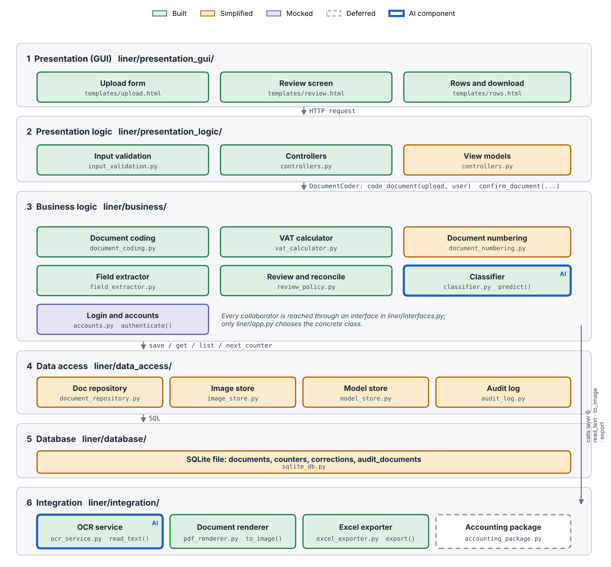

# LineR (IS3329 Deliverable 2)


LineR reads an Irish invoice or receipt with OCR, shows the extracted fields next to the image so you
check them instead of typing them, suggests a VAT band for lines that print none, splits the document
into one row per tax band, numbers it, and exports the rows to Excel.

Repository: https://github.com/Marksheehan13/LineR

This is a prototype: **one hard-coded demo user, local use only, synthetic documents only.** Do not
upload real client documents.

## What you need

| Needs | Why |
|---|---|
| Python 3.10 or newer (tested on 3.13) | the application |
| **Tesseract OCR** (the program, not just the Python package) | reads the text from images |
| **Poppler** | turns a PDF's first page into an image |

Install the two programs:

- **macOS:** `brew install tesseract poppler`
- **Ubuntu / Debian:** `sudo apt install tesseract-ocr poppler-utils`
- **Windows (PowerShell):**
  ```
  winget install UB-Mannheim.TesseractOCR
  winget install oschwartz10612.Poppler
  ```
  Then add both programs to your `PATH` (this also fixes it for the current window), and **reopen
  your terminal or IDE**:
  ```
  $pop = (Get-ChildItem "$env:LOCALAPPDATA\Microsoft\WinGet\Packages" -Recurse -Filter pdftoppm.exe | Select-Object -First 1).DirectoryName
  $tess = "C:\Program Files\Tesseract-OCR"
  $env:Path += ";$tess;$pop"
  [Environment]::SetEnvironmentVariable("Path", [Environment]::GetEnvironmentVariable("Path","User") + ";$tess;$pop", "User")
  ```
  Check with `tesseract --version` and `pdftoppm -v`. If either says "not recognized", the tests that
  read images or PDFs fail or skip.

## Install, run, test

From this folder:

```bash
python -m venv .venv
source .venv/bin/activate          # Windows: .venv\Scripts\activate
pip install -r requirements.txt

python -m pytest -q                # all 227 tests, one command (a bare `pytest` also works)
python run.py                      # then open http://127.0.0.1:5000
```

Coverage and lint, as run in CI:

```bash
python -m pytest -q --cov=liner    # about 96% of liner/
ruff check .
```

On first start the app trains its classifier on 2,000 synthetic lines (about a second) and saves it
under `var/models/`. Everything the app stores (database, uploaded images, model) is under `var/`;
delete that folder to start clean.

## Try it

Sample documents are in `data/sample_documents/` (each exists at three quality levels, with a `.json`
file holding the correct answer). Try:

1. `doc000_invoice_clean.png`: rates are printed, so nothing is suggested. Accept and see one row per band.
2. `doc001_receipt_clean.png`: no rate printed, so each line gets an **AI suggestion** you must tick or change.
3. A `*_poor.jpg` file or a blurred image: the screen says it could not be read, fills nothing in, and lets you type it.
4. Change a total so the lines no longer add up: the document cannot be saved and the difference is shown.

Make more documents: `python -m tools.make_documents --out data/synthetic --n 30 --seed 7`.
Measure reading accuracy on them: `python -m tools.evaluate --dir data/synthetic`.
Train and evaluate the classifier: `python -m tools.train_classifier`.

## How the code matches the design



The package mirrors the six layers of the target architecture (Deliverable 1, section 1.3). One module per
component; `tests/test_architecture.py` fails if a layer imports another instead of using an interface.

| Layer | Folder | Modules |
|---|---|---|
| 1 Presentation (GUI) | `liner/presentation_gui/` | `templates/` (upload, review, rows), `static/` |
| 2 Presentation logic | `liner/presentation_logic/` | `input_validation.py`, `controllers.py` (routes and view models) |
| 3 Business logic | `liner/business/` | `document_coding.py`, `vat_calculator.py`, `document_numbering.py`, `field_extractor.py`, `review_policy.py`, `classifier.py` (AI), `accounts.py` (mock) |
| 4 Data access | `liner/data_access/` | `document_repository.py`, `image_store.py`, `model_store.py`, `audit_log.py` |
| 5 Database | `liner/database/` | `sqlite_db.py` |
| 6 Integration | `liner/integration/` | `ocr_service.py` (AI), `pdf_renderer.py`, `excel_exporter.py`, `accounting_package.py` (deferred) |

Shared by all layers: `liner/models.py` (plain data types), `liner/interfaces.py` (the interfaces between
components), `liner/parsing.py` (amount/date/rate parsing), `liner/config.py`.
`liner/app.py` is the **only** place that picks a concrete class for each interface.

Swapping a component: write one class that satisfies the interface in `liner/interfaces.py` and change one
line in `liner/app.py`. For example the OCR engine is used only through `read_text(image)`; the tests run the
whole feature with a fake engine behind the same method.

## Configuration

`liner/config.py` holds the limits (upload size 5 MB, one PDF page, OCR timeout 30 s) and review
thresholds. Nothing secret is stored in the repository. `LINER_DATA_DIR` moves the data folder;
`LINER_SECRET_KEY` sets Flask's session key (a random one is made at start-up otherwise).

## Known limits

- One document per upload; line amounts are read as VAT-inclusive; the rightmost amount on a line is taken as its amount.
- Rates are read when printed as a percentage (23%), not as letter codes.
- The band labels used to train the classifier are illustrative (`tools/vocabulary.py`), not tax advice.
- No login, no CSRF protection, no retention limit on stored images: acceptable for a local demo, required for real use.

Full detail is in the technical document (`docs/IS3329_D2_Technical_Document.docx`). The deviation log and the risk update are also in `docs/DEVIATION_LOG.md` and `docs/RISKS.md`.
